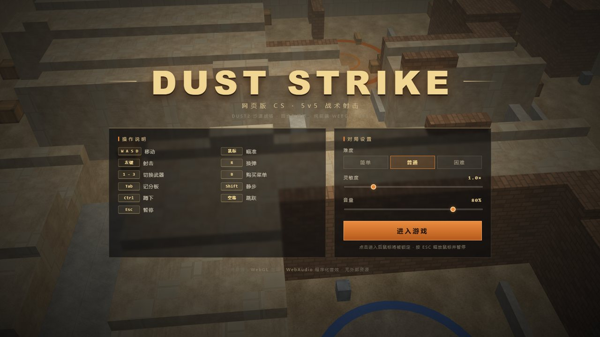
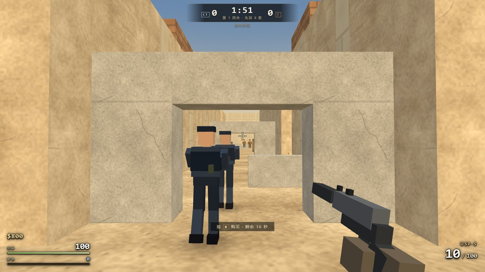
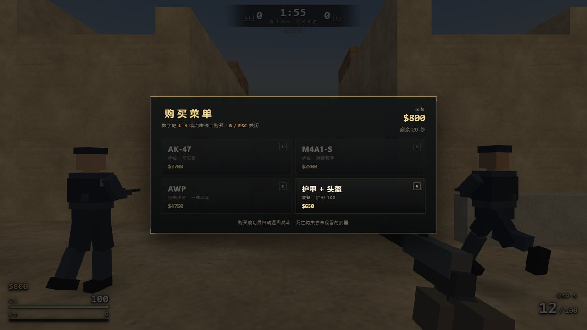
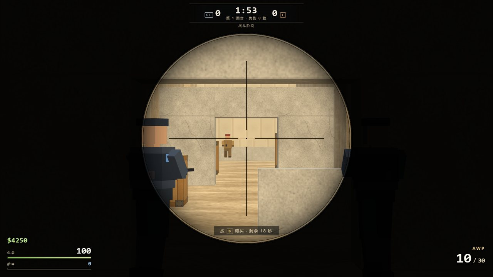
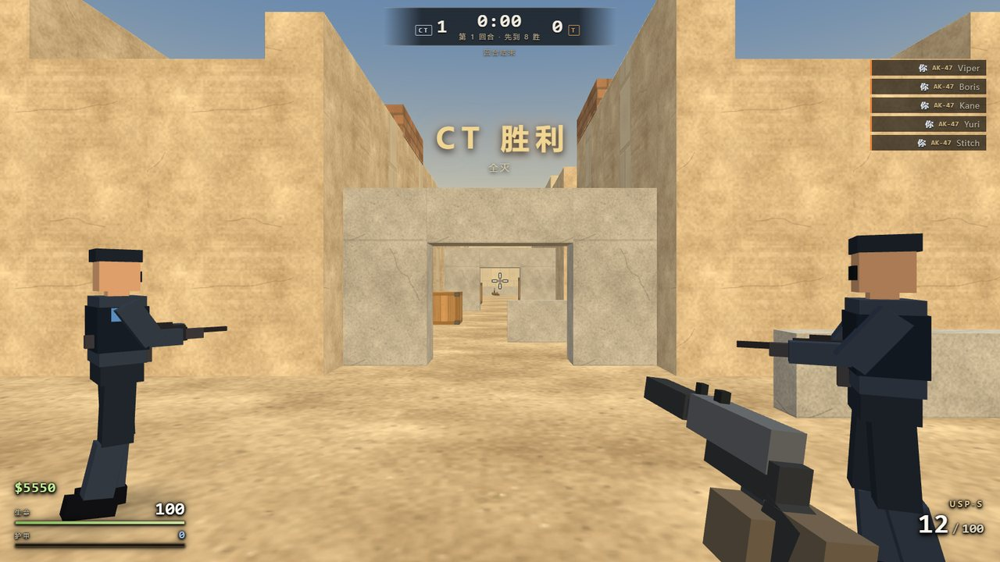
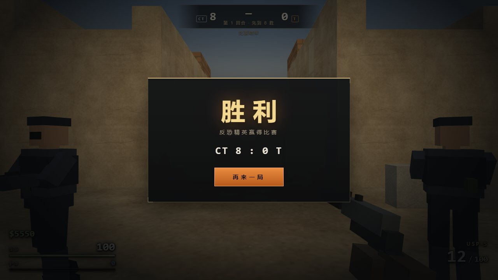
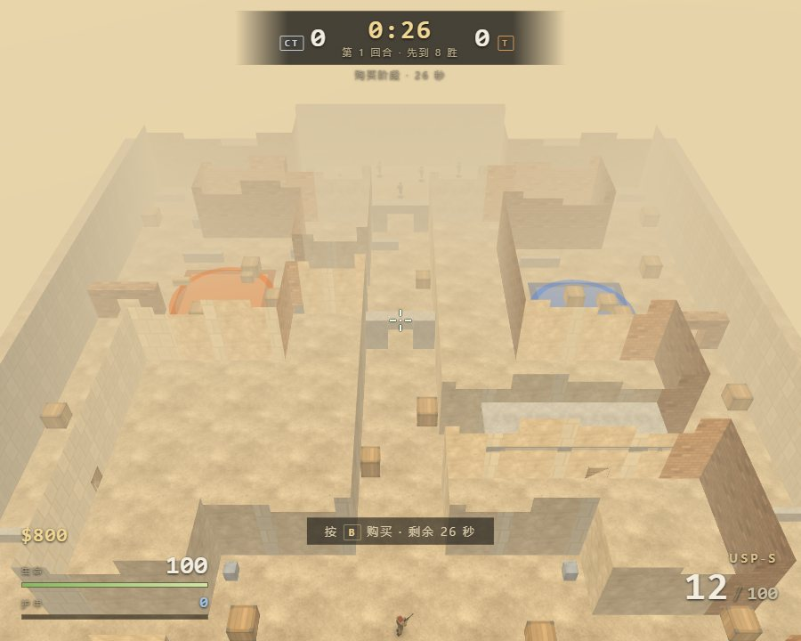

# DUST STRIKE · 网页版 CSGO

一个**零依赖、零构建、纯前端 WebGL** 的类 CSGO 第一人称射击游戏。双击 `index.html` 即可在浏览器里玩，不需要安装、不需要联网、不加载任何外部资源（模型/纹理/音效全部由代码程序化生成）。

5v5 战术对抗：你是反恐精英（CT），4 个 CT 机器人队友 vs 5 个 T 机器人，先赢 8 回合获胜。购买经济、AK/M4/AWP/USP/Glock、爆头、后坐力、A 大/B 包点、回合制、计分板、击杀信息流、合成音效全部具备。

## 在线试玩

- 🌐 个人站：**https://games.honala.xyz/dust-strike/**
- 🐙 GitHub Pages：https://honala.github.io/dust-strike/
- 📦 GitHub 仓库：https://github.com/honala/dust-strike



---

## 快速开始

1. 双击 `csgo-web/index.html`（推荐 **Chrome / Edge**，需支持 WebGL）。
2. 在开始界面选择难度（简单 / 普通 / 困难）、调整鼠标灵敏度和音量。
3. 点击 **进入游戏** → 鼠标会被锁定 → 开始第 1 回合（8 秒购买阶段后开打）。
4. 按 `Esc` 释放鼠标 / 打开暂停菜单；继续游戏点击画面或菜单里的「继续游戏」。

> 如果浏览器不锁定鼠标，点击一下游戏画面即可重新锁定。

## 操作

| 按键 | 功能 |
|---|---|
| `W A S D` | 移动 |
| 鼠标 | 瞄准 |
| 鼠标左键 | 射击（步枪按住连发，手枪/狙单击） |
| 鼠标右键 | AWP 开镜 |
| `R` | 换弹 |
| `1 / 2 / 3` | 主武器 / 副武器 / 刀 |
| `B` | 购买菜单（购买阶段 / 回合开始 20 秒内且在出生区） |
| `Shift` | 静步 |
| `Ctrl` | 蹲下 |
| `空格` | 跳跃 |
| `Tab`（按住） | 记分板 |
| `Esc` | 暂停菜单 |

## 玩法

- **比赛**：先赢 8 回合的一方获胜；回合胜利条件为全歼对方（本作无炸弹，时间耗尽判 CT 胜）。
- **经济**：初始 $800；击杀 +$300；回合胜 +$3250；回合败 +$1400（上限 $16000）。
- **购买**：AK-47 $2700 / M4A1-S $2900 / AWP $4750 / 护甲+头盔 $650。阵亡后下回合只保留手枪+刀；存活则保留武器与剩余弹药。
- **武器手感**：每把枪有独立伤害/射速/弹匣/换弹时间/散布与后坐力；AK/M4 按住左键连发需要压枪，AWP 开镜爆头必杀，护甲减伤 50%。
- **机器人**：会寻路、分兵进攻/防守 A、B 点和中路，有视野/听声、反应时间、点射、换弹、低血撤退；难度影响反应、瞄准误差和压制力。













## 技术实现

- **渲染**：手写 WebGL 渲染器（无 three.js）——方向光+半球环境光+距离雾、程序化天空、14 种 Canvas 生成的 256² 可平铺纹理（沙地/灰泥/石墙/土砖/木箱/金属/混凝土…）、静态几何按材质合批、CPU 合批的 tinted box、透明队列排序、弹孔贴花、粒子（火花/尘土/血/抛壳/枪口火焰/弹道）。
- **物理/碰撞**：AABB 分轴扫掠滑动（贴墙滑动、落地、顶头、可跳上矮箱）、射线检测、视线检测。
- **AI**：0.75m 导航网格 + A* 寻路（路径拉直、限流重算、卡住恢复）、状态机（推进/交火/听声搜索/死亡）、与玩家共用同一套命中判定与武器数值。
- **玩家**：CS 式加速/摩擦/跳跃/蹲下、动态散布+后坐力、开镜、换弹/切枪动画、第一人称枪模（纯盒子拼装）。
- **HUD/菜单**：自建 DOM+CSS，开始/暂停/购买/记分板/比赛结束/死亡遮罩/动态准星/命中标记/受击提示/击杀信息流。
- **音效**：WebAudio 程序化合成 22 种音效（枪声有低频砰+噪声爆裂，各枪音色区分、空间声像与距离衰减；脚步/换弹/命中/爆头/回合提示/购买/空仓…），无音频文件。
- **零外部依赖**：不加载任何 CDN/图片/字体/音频；`file://` 双击直接运行。

## 文件结构

```
csgo-web/
├── index.html          入口页面（双击即玩）
├── CONTRACT.md         开发时的团队接口契约（可忽略）
├── README.md           本文件
├── js/
│   ├── math.js         向量/矩阵/射线数学
│   ├── glcore.js       WebGL 渲染器 + 程序化纹理
│   ├── fx.js           弹道/弹孔/粒子特效
│   ├── world.js        dust2 风格地图、碰撞、A* 导航
│   ├── weapons.js      武器数值、命中与伤害
│   ├── player.js       玩家控制、射击/后坐力、第一人称枪模
│   ├── bots.js         机器人 AI、寻路、人形渲染
│   ├── audio.js        WebAudio 合成音效
│   ├── hud.js          HUD/菜单/准星/记分板
│   ├── rules.js        回合流程、经济、购买
│   └── main.js         主循环、输入、指针锁、事件分发
├── docs/screenshots/   仓库用截图（压缩后）
├── tools/              开发自测工具（无头截图/CDP 集成测试/各模块自测页）
└── shots/              本地验收截图（.gitignore，不进入仓库）
```

## 调试参数（挂在 index.html 后）

| 参数 | 作用 |
|---|---|
| `?auto=1` | 跳过开始界面自动开局（无头测试用） |
| `?auto=1&live=1` | 自动开局并跳过购买冻结，直接进入 live |
| `?hideui=1` | 隐藏全部 HUD，只看 3D |
| `?mapview=1` | 俯视整张地图 |
| `?selftest=1` | 会把一局状态 JSON 写进 `#dsh-selftest`（配合无头 Chrome dump-dom） |
| `?norender=1&fast=10` | 不渲染，每帧多步模拟，用于快速验证回合/AI 逻辑 |

开发期无头验证脚本：`node tools/cdp-test.js "?auto=1&live=1" shots/x.png 6000 "move,shoot"`（Chrome DevTools Protocol 驱动，可截图并输出游戏状态/错误报告）。

## 已知限制

- 无炸弹拆包模式（回合胜负 = 全歼 / 时间到）。
- 机器人是盒子人形，死亡为整体倒地淡出（无 ragdoll）；简单难度偏被动、困难难度很凶。
- 第一人称枪模与场景共用深度缓冲，贴墙极近时枪口理论上可能轻微穿墙（已限制到距相机 ≥0.35m）。
- 需要支持 WebGL 的现代浏览器；老旧浏览器会在加载界面提示启动失败。

---

**祝你好运，反恐精英。** 🎯
